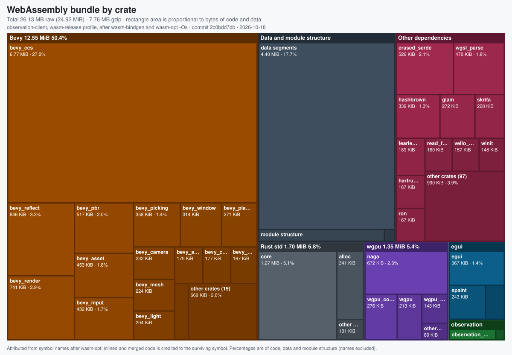

# Observation

[](https://github.com/panevain/observation/actions/workflows/ci.yml)
[](https://github.com/panevain/observation/actions/workflows/security.yml)
[](https://github.com/panevain/observation/actions/workflows/codeql.yml)
[](https://scorecard.dev/viewer/?uri=github.com/panevain/observation)

Observation shows how much of a suburban street common home surveillance cameras can see. Pick a street (or use the bundled demo), place cameras from a catalogue of popular doorbell, floodlight and bullet models, and the app draws what each one covers on the road and on building walls, with buildings blocking the view. It exists to make the reach of everyday home cameras easy to see and discuss.

> [!WARNING]
> **AI-generated, not for serious use.** The code, documentation and camera data in this repository were generated by an AI model (Claude, via Claude Code) under human direction and have not been independently audited. Treat it as a demonstration: do not rely on its coverage figures for security, legal, privacy-compliance, insurance or planning decisions. It is provided "as is", without warranty of any kind (see the licences).

Coverage is an estimate. It is modelled from published field of view, resolution and night-vision range, and from OpenStreetMap building footprints with inferred heights, on the ground's real shape from a public elevation model. It ignores trees, fences and vehicles. See [limitations](docs/usage.md#limitations-and-accuracy).

## Quick start

### Docker

```sh
docker run --rm -p 8080:8080 -e OBS_CONTACT=you@example.com ghcr.io/panevain/observation   # the latest release
docker build -t observation . && docker run --rm -p 8080:8080 -e OBS_CONTACT=you@example.com observation   # or from source
```

Released images are signed: from a checkout, `mise run verify ghcr.io/panevain/observation:<version>` checks one and prints it pinned by digest, which you can then `docker run` (see [SECURITY.md](SECURITY.md)).

The MCP server for AI agents is an image too. It speaks MCP over stdio and works offline on the demo street, so an MCP client runs it with stdin attached, no TTY and no network:

```sh
docker run --rm -i --network none ghcr.io/panevain/observation-mcp   # or `docker build --target mcp`
```

#### AI agents

The MCP server (`observation-mcp`) gives an agent the camera catalogue, scene editing and coverage figures, and the places you and the agent both name: areas labelled as your own, a neighbour's or public, and targets such as a front door. It reports where each camera's footage lands, whether the model rules out that a camera sees a target or a point and why, and the largest stretches of street no camera sees. To let it see what you have open in the app, and work on your real area instead of the demo street, start the server with the agent bridge on and open the app on the same computer:

```sh
OBS_AGENT_BRIDGE=on OBS_BIND=127.0.0.1:8080 cargo run -p observation-server   # or the image with --network host
```

Then click **Connect agent** in the app and give the agent the code it shows (see [Connect an AI agent](docs/usage.md#connect-an-ai-agent)). The agent can then propose changes to your scene (`propose_changes`), which you review on a card in the app, with a ghost preview and before and after figures, and accept or reject as a whole; nothing changes until you accept (see [Review a proposal](docs/usage.md#review-a-proposal)). The bridge answers only requests from this computer, and the server refuses to start with it on behind a reverse proxy (`OBS_TRUSTED_PROXIES`). The MCP server must reach the app's server on 127.0.0.1: run its binary on the host (`cargo run -p observation-mcp`, as `.mcp.json` does), or the image with `--network host` instead of `--network none` (on Linux; the image then needs the app's server on the host's loopback). Under Docker's port publishing the app's server sees every request as coming from the Docker network, not loopback, so the bridge refuses it: run the app's server on the host or with `--network host` too. See [Agent bridge](docs/design.md#agent-bridge).

Open <http://localhost:8080>. `OBS_CONTACT` goes into the `User-Agent` sent to OpenStreetMap services so they can reach you; set it to something real.

### Docker Compose, with local map data

Public Overpass servers are often slow or busy. `compose.yaml` runs the app with an optional **region agent** that imports whole Geofabrik extracts (a city, state or country) into its own Overpass databases, so areas inside them load in milliseconds:

```sh
cp mise.local.toml.example mise.local.toml   # set OBS_CONTACT
# set OBS_REGIONS_TOKEN and OBS_ADMIN_TOKEN in fnox.local.toml (see fnox.toml)
mise run up                                  # the released images, signature-checked; `mise run up --build` builds them here, the MCP server's too
```

The tokens are read by [fnox](https://fnox.jdx.dev), which mise installs for that task; the port, log format and region limits default in [`compose.yaml`](compose.yaml) (override one from the environment, e.g. `OBS_PORT=9090 mise run up`). Open <http://localhost:8080>, click the database button in the top bar, enter the admin token, and import a region; progress shows live in the browser. Areas elsewhere still use public Overpass. See [Local regions](docs/design.md#local-regions).

On a host that only runs the stack, `echo 'env = []' > .miserc.local.toml` (gitignored) keeps mise from loading `mise.dev.toml`, the development tasks, as `.miserc.toml` would; the host needs a mise at least as new as the `soft` value of `min_version` in `mise.toml` (the CI version; older releases ignore `.miserc.local.toml`).

### From source

You need the toolchain pinned in [`rust-toolchain.toml`](rust-toolchain.toml) (with the `wasm32-unknown-unknown` target) and [trunk](https://trunkrs.dev) (the version pinned in [`mise.toml`](mise.toml)). [mise](https://mise.jdx.dev) installs both (Rust via rustup) and provides the tasks below:

```sh
mise install                          # Rust (via rustup), trunk and the check tools (checksum-verified via mise.lock)
cp mise.local.toml.example mise.local.toml   # then set OBS_CONTACT (gitignored)
mise run serve                        # dev-build the client -> dist/, then run the server
mise run dev                          # the same plus a region agent built from this checkout (Docker; mise.dev.toml)
```

Without mise, run `rustup toolchain install` in the repository (`rust-toolchain.toml` is the single source for the Rust version), install trunk, then run the underlying commands directly:

```sh
trunk build --release                 # client -> dist/
cargo run --release -p observation-server
```

The server listens on `0.0.0.0:8080` and serves the `dist/` directory relative to the working directory by default (`OBS_STATIC_DIR`), so run it from the repository root. For local use, add `OBS_BIND=127.0.0.1:8080` and `OBS_CONTACT=you@example.com` (with mise, put them in `mise.local.toml`). Cached map data goes to `cache/` (`OBS_CACHE_DIR`).

Dev loop: the server reads `dist/` from disk on every request, so after the first build you can rerun `trunk build` and refresh the browser without restarting the server. `trunk serve` has no API proxy configured, so use the server to test anything that loads map data. The demo street needs no network except for map tile images. Server and core crates build natively with plain `cargo` (the client is excluded from the default workspace members).

## Supported screens

Tablets and desktops with a viewport of at least 768 x 600 CSS px, in a browser with WebAssembly and WebGL2. Smaller screens see a "Larger screen needed" notice instead of the app.

## Bundle size

The shipped WebAssembly module is 26.1 MB raw and 7.8 MB gzip. See [Bundle size](docs/design.md#bundle-size) for what dominates it and how to regenerate this chart.

[](docs/design.md#bundle-size)

## Repository layout

| Path | Contents |
| --- | --- |
| `crates/observation-core` | Engine-free logic shared by client and server: projection, tiles, building extrusion, bundle format, cameras, view cones, occlusion, coverage, scene files |
| `crates/observation-mapdata` | Map data without I/O: the Overpass response parser, Terrarium elevation tile decoding, and the demo street with its committed fixtures |
| `crates/observation-server` | axum server: Overpass pipeline, bundle cache, tile proxy, demo street, region management relay, static files |
| `crates/observation-regions` | Optional region agent (`regions` image target): imports Geofabrik extracts into local Overpass databases and answers queries for them |
| `crates/observation-tokens` | Design token values (scales, minimum viewport, UI colour roles) shared by the client theme and `web/index.html`'s CSS, which trunk writes with its `token-css` binary |
| `crates/observation-mcp` | MCP server for AI agents (stdio, `mcp` image target): the camera catalogue, scene editing and coverage figures on the demo street, offline, or on the user's real area when connected to the open app |
| `crates/observation-agent-api` | The agent bridge's contract between the browser, the server and the MCP server: routes, limits, versioned bodies, and the agent's proposals and the user's decisions |
| `crates/observation-client` | Bevy/egui client compiled to WebAssembly; embeds the camera catalogue |
| `web/` | `index.html` trunk entry point: loading screen and small-screen gate (`tokens.css` is generated) |
| `docs/` | [usage](docs/usage.md), [design](docs/design.md), [camera catalogue](docs/camera-catalog.md) |
| `scripts/` | Shell and Python helpers that the workflows and mise tasks run: the release steps on the bot's paths, image smoke tests and verification, `wasm-size-report.sh` (regenerates the bundle-size treemap with `cargo xtask treemap`) and `wasm-size-treemap.py`, kept as the reference for that command's parity tests (see [Repository tooling](docs/design.md#repository-tooling)) |
| `xtask/` | Repository tooling, run as `cargo xtask <command>` (its own workspace), such as the design-token check CI runs |
| `.github/` | CI, security, CodeQL, Scorecard and release workflows; Dependabot config |

## Documentation

- [Using the app](docs/usage.md)
- [Architecture and design](docs/design.md), including configuration, security and testing
- [Camera catalogue](docs/camera-catalog.md): sources and how to add a model
- [Contributing](CONTRIBUTING.md): git-flow branching, rulesets and required checks
- [Security policy](SECURITY.md): supported versions and how to report a vulnerability

## Copyright and licensing

Code is offered under MIT OR Apache-2.0 ([LICENSE-MIT](LICENSE-MIT), [LICENSE-APACHE](LICENSE-APACHE)), at your option.

- **AI-generated material.** Most of this repository was produced by an AI model. Whether, and to what extent, such material is protected by copyright is unsettled and differs between jurisdictions (for example, the US Copyright Office does not register material lacking sufficient human authorship). The licences apply to the extent copyright exists; nothing here grants rights in third-party material.
- **Dependencies** keep their own licences; `cargo deny check licenses` enforces a permissive allow-list (see `deny.toml`).
- **Camera specifications** are factual figures taken from the manufacturers' published spec pages, cited per model in the catalogue. Product names and trademarks belong to their owners; this project is not affiliated with or endorsed by any manufacturer, OpenStreetMap or the OpenStreetMap Foundation.
- **Map data** and buildings are © OpenStreetMap contributors, available under the [ODbL](https://www.openstreetmap.org/copyright). The server follows the OSM tile usage policy and Overpass fair-use guidance (identifying `User-Agent`, `Referer` forwarding, caching, bounded concurrency, visible attribution); details in [docs/design.md](docs/design.md#tile-proxy-and-osm-policy-compliance). The default upstreams are public community services, so put a heavily used deployment on its own tile and Overpass providers via `OBS_TILE_URL` and `OBS_OVERPASS_URL`.
- **Elevation data** comes from the [Terrain Tiles](https://registry.opendata.aws/terrain-tiles/) open dataset (Mapzen, with USGS 3DEP, SRTM, GMTED2010, EU-DEM and national sources; required credits in [its attribution list](https://github.com/tilezen/joerd/blob/master/docs/attribution.md)), shown in the status bar. `OBS_DEM_URL` picks another source, or `off` for flat ground; see [Terrain](docs/design.md#terrain).

No telemetry: the app and server have no analytics, crash reporting or update checks, and the browser only talks to its own server. The only outbound traffic is the OpenStreetMap tile and Overpass requests and the elevation tile requests the server makes for you; see [Privacy and network traffic](docs/design.md#privacy-and-network-traffic).
