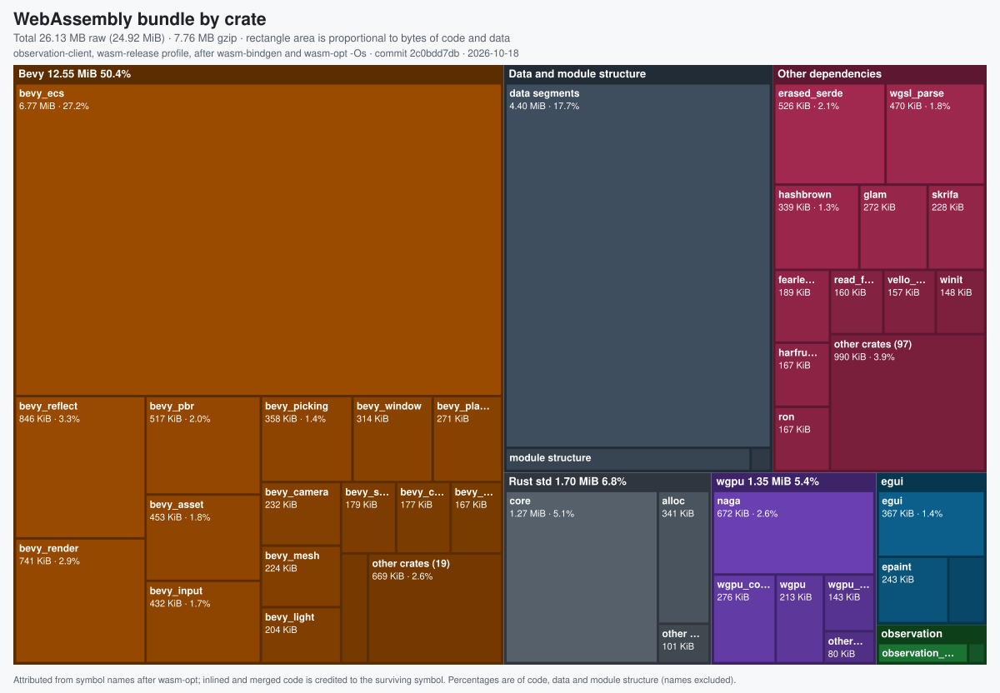

# Observation

[](https://github.com/panevain/observation/actions/workflows/ci.yml)
[](https://github.com/panevain/observation/actions/workflows/security.yml)
[](https://github.com/panevain/observation/actions/workflows/codeql.yml)
[](https://scorecard.dev/viewer/?uri=github.com/panevain/observation)

Observation shows how much of a suburban street common home surveillance cameras can see. Pick a street (or use the bundled demo), place cameras from a catalogue of popular doorbell, floodlight and bullet models, and the app draws what each one covers on the road and on building walls, with buildings blocking the view. It exists to make the reach of everyday home cameras easy to see and discuss.

> [!WARNING]
> **AI-generated, not for serious use.** The code, documentation and camera data in this repository were generated by an AI model (Claude, via Claude Code) under human direction and have not been independently audited. Treat it as a demonstration: do not rely on its coverage figures for security, legal, privacy-compliance, insurance or planning decisions. It is provided "as is", without warranty of any kind (see the licences).

Coverage is an estimate. It is modelled from published field of view, resolution and night-vision range, and from OpenStreetMap building footprints with inferred heights. It ignores trees, fences, vehicles and terrain. See [limitations](docs/usage.md#limitations-and-accuracy).

## Quick start

### Docker

```sh
docker build -t observation .
docker run --rm -p 8080:8080 -e OBS_CONTACT=you@example.com observation
```

Open <http://localhost:8080>. `OBS_CONTACT` goes into the `User-Agent` sent to OpenStreetMap services so they can reach you; set it to something real.

### Docker Compose, with local map data

Public Overpass servers are often slow or busy. `compose.yaml` runs the app with an optional **region agent** that imports whole Geofabrik extracts (a city, state or country) into its own Overpass databases, so areas inside them load in milliseconds:

```sh
cp mise.local.toml.example mise.local.toml   # set OBS_CONTACT
# set OBS_REGIONS_TOKEN and OBS_ADMIN_TOKEN in fnox.local.toml (see fnox.toml)
mise run up                                  # fnox exec -- docker compose up -d --build
```

This needs [fnox](https://fnox.jdx.dev) (`mise use -g fnox`) for the tokens. Open <http://localhost:8080>, click the database button in the top bar, enter the admin token, and import a region; progress shows live in the browser. Areas elsewhere still use public Overpass. See [Local regions](docs/design.md#local-regions).

### From source

You need the toolchain pinned in [`rust-toolchain.toml`](rust-toolchain.toml) (with the `wasm32-unknown-unknown` target) and [trunk](https://trunkrs.dev) 0.21.14. [mise](https://mise.jdx.dev) installs both (Rust via rustup) and provides the tasks below:

```sh
mise install                          # Rust (via rustup) and trunk (checksum-verified via mise.lock)
cp mise.local.toml.example mise.local.toml   # then set OBS_CONTACT (gitignored)
mise run serve                        # dev-build the client -> dist/, then run the server
```

Without mise, run `rustup toolchain install` in the repository (`rust-toolchain.toml` is the single source for the Rust version), install trunk, then run the underlying commands directly:

```sh
trunk build --release                 # client -> dist/
cargo run --release -p observation-server
```

The server listens on `0.0.0.0:8080` and serves the `dist/` directory relative to the working directory by default (`OBS_STATIC_DIR`), so run it from the repository root. For local use, add `OBS_BIND=127.0.0.1:8080` and `OBS_CONTACT=you@example.com` (with mise, put them in `mise.local.toml`). Cached map data goes to `cache/` (`OBS_CACHE_DIR`).

Dev loop: the server reads `dist/` from disk on every request, so after the first build you can rerun `trunk build` and refresh the browser without restarting the server. `trunk serve` has no API proxy configured, so use the server to test anything that loads map data. The demo street needs no network except for map tile images. Server and core crates build natively with plain `cargo` (the client is excluded from the default workspace members).

## Supported screens

Tablets and desktops with a viewport of at least 768 x 600 CSS px, in a browser with WebAssembly and WebGL2. Smaller screens see a "Larger screen needed" notice instead of the app.

## Bundle size

The shipped WebAssembly module is 26.1 MB raw and 7.8 MB gzip. See [Bundle size](docs/design.md#bundle-size) for what dominates it and how to regenerate this chart.

[](docs/design.md#bundle-size)

## Repository layout

| Path | Contents |
| --- | --- |
| `crates/observation-core` | Engine-free logic shared by client and server: projection, tiles, building extrusion, bundle format, cameras, view cones, occlusion, coverage, scene files |
| `crates/observation-server` | axum server: Overpass pipeline, bundle cache, tile proxy, demo street, region management relay, static files |
| `crates/observation-regions` | Optional region agent (`regions` image target): imports Geofabrik extracts into local Overpass databases and answers queries for them |
| `crates/observation-client` | Bevy/egui client compiled to WebAssembly; embeds the camera catalogue |
| `web/` | `index.html` trunk entry point: loading screen and small-screen gate |
| `docs/` | [usage](docs/usage.md), [design](docs/design.md), [camera catalogue](docs/camera-catalog.md) |
| `scripts/` | `check-design-tokens.sh` (colour-literal guard run in CI); `wasm-size-report.sh` and `wasm-size-treemap.py` (regenerate the bundle-size treemap) |
| `.github/` | CI, security, CodeQL, Scorecard and release workflows; Dependabot config |

## Documentation

- [Using the app](docs/usage.md)
- [Architecture and design](docs/design.md), including configuration, security and testing
- [Camera catalogue](docs/camera-catalog.md): sources and how to add a model
- [Contributing](CONTRIBUTING.md): git-flow branching, rulesets and required checks
- [Security policy](SECURITY.md): supported versions and how to report a vulnerability

## Copyright and licensing

Code is offered under MIT OR Apache-2.0 ([LICENSE-MIT](LICENSE-MIT), [LICENSE-APACHE](LICENSE-APACHE)), at your option.

- **AI-generated material.** Most of this repository was produced by an AI model. Whether, and to what extent, such material is protected by copyright is unsettled and differs between jurisdictions (for example, the US Copyright Office does not register material lacking sufficient human authorship). The licences apply to the extent copyright exists; nothing here grants rights in third-party material.
- **Dependencies** keep their own licences; `cargo deny check licenses` enforces a permissive allow-list (see `deny.toml`).
- **Camera specifications** are factual figures taken from the manufacturers' published spec pages, cited per model in the catalogue. Product names and trademarks belong to their owners; this project is not affiliated with or endorsed by any manufacturer, OpenStreetMap or the OpenStreetMap Foundation.
- **Map data** and buildings are © OpenStreetMap contributors, available under the [ODbL](https://www.openstreetmap.org/copyright). The server follows the OSM tile usage policy and Overpass fair-use guidance (identifying `User-Agent`, `Referer` forwarding, caching, bounded concurrency, visible attribution); details in [docs/design.md](docs/design.md#tile-proxy-and-osm-policy-compliance). The default upstreams are public community services, so put a heavily used deployment on its own tile and Overpass providers via `OBS_TILE_URL` and `OBS_OVERPASS_URL`.

No telemetry: the app and server have no analytics, crash reporting or update checks, and the browser only talks to its own server. The only outbound traffic is the OpenStreetMap tile and Overpass requests the server makes for you; see [Privacy and network traffic](docs/design.md#privacy-and-network-traffic).
